


 

[About](#about) &nbsp;·&nbsp; [Experience](#experience) &nbsp;·&nbsp; [Achievements](#achievements) &nbsp;·&nbsp; [Projects](#projects) &nbsp;·&nbsp; [Skills](#skills) &nbsp;·&nbsp; [Activity](#activity) &nbsp;·&nbsp; [Connect](#connect)

 




&nbsp; Final-semester CSE student at **Satkhira Polytechnic Institute** 
&nbsp; **Full Stack Developer** working across **MERN, Next.js and WordPress** to build performant, user-friendly web apps 
&nbsp; **1+ year of professional experience** at **Exprovia** 
&nbsp; Custom React / Next.js apps, WordPress theme & plugin customization, and full backend development 
&nbsp; Exploring advanced backend security & authentication 
&nbsp; Deploying on **Firebase, Vercel and Netlify** 
&nbsp; Based in **Jashore, Khulna, Bangladesh** 
&nbsp; Off the keyboard, you'll find me playing **cricket** 
&nbsp; Inspired by **Jhankar Mahbub** and **Rasel Mridha** (mentor & friend)

> *"Never stop learning because life never stops teaching."*


&nbsp; **Full Stack Developer** — **Exprovia** &nbsp;·&nbsp; *1+ year*

> Working on full-stack web development spanning **MERN stack applications**, **Next.js projects**, and **WordPress-based client solutions**, contributing to real-world production builds and client-facing deliverables.


<table>
  <tr>
    <td align="center" width="170"> <b>Pair Extraordinaire</b></td>
    <td align="center" width="170"> <b>Pull Shark ×2</b></td>
    <td align="center" width="170"> <b>Quickdraw</b></td>
  </tr>
</table>

GitHub achievements, as shown on my <a href="https://github.com/tumit-h-r-75?tab=achievements">profile</a>.


&nbsp; **Kaimana** &nbsp;    
Coding-practice platform: solve algorithm problems against a real judge, get AI hints, Big-O audits and refactor notes, then compete in live contests. 
Next.js · TypeScript · Socket.IO · Express · MongoDB

&nbsp; **GearUp** &nbsp;   
Sports & outdoor gear rental: book gear from verified local providers, pick your dates and pay securely. 
Next.js · TypeScript · Express · Prisma · PostgreSQL · Stripe

&nbsp; **App Orbit** &nbsp;   
Full-stack MERN application with Firebase and Stripe integration. 
React · Tailwind CSS · Node.js · Express · MongoDB

&nbsp; **Volunteer Hub** &nbsp;   
Full-stack MERN application with a REST API backend. 
React · Tailwind CSS · Firebase · Node.js · Express · MongoDB

&nbsp; **Roommate Finder** &nbsp;  
Full-stack app to help users find compatible roommates. 
React · Firebase · MongoDB

See all repositories on my <a href="https://github.com/tumit-h-r-75?tab=repositories">GitHub profile</a>.


  

| Category | Stack |
|:--|:--|
| &nbsp; **Languages** | JavaScript · TypeScript · PHP · HTML5 · CSS3 |
| &nbsp; **Frontend** | React.js · Next.js · Tailwind CSS |
| &nbsp; **Backend** | Node.js · Express.js · Prisma |
| &nbsp; **CMS** | WordPress (theme & plugin customization, Elementor, WooCommerce) |
| &nbsp; **Database** | MongoDB · PostgreSQL · Firebase Realtime Database |
| &nbsp; **Auth & Security** | JWT · Firebase Authentication |
| &nbsp; **Tools & Deploy** | Git · Figma · VS Code · Vercel · Netlify · Firebase |


  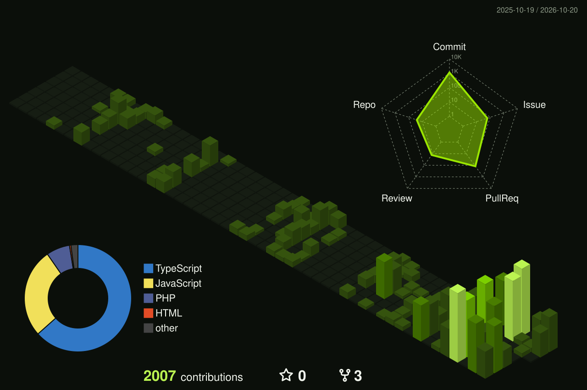

Rebuilt every day from my real GitHub contribution data by a GitHub Action.

  
  

  

<b>Full metrics dashboard</b> (auto-updated daily)

 

  


  
  
  
  
  
  

  &nbsp; Jashore, Khulna, Bangladesh

&nbsp; **If you like my work, consider starring my repositories.** 
Always open to collaborations, freelance gigs, and learning opportunities.

  


